<p align="center">
  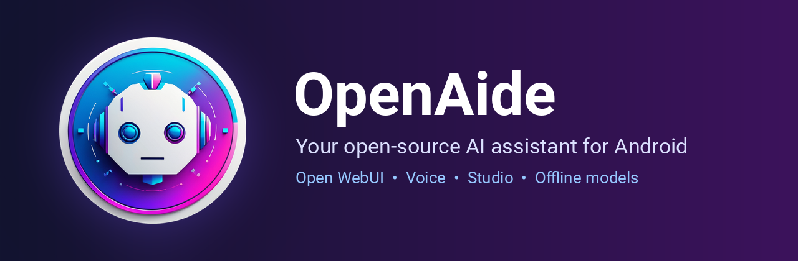
</p>

<p align="center">
  <a href="../../releases/latest"></a>
  
  <a href="LICENSE"></a>
  <a href="https://github.com/open-webui/open-webui"></a>
</p>

<p align="center">
  <b><a href="../../releases/latest">Download the latest APK</a></b> ·
  <a href="#install">Install guide</a> ·
  <a href="#getting-started">Getting started</a> ·
  <a href="#features">Features</a>
</p>

**OpenAide** is a free, open-source AI assistant for Android. Connect it to your own [Open WebUI](https://github.com/open-webui/open-webui) server for full feature parity with the web UI, or use it on its own with an AI provider (OpenRouter, Claude, OpenAI) or a model that runs entirely on your phone. It can even replace the default Android assistant.

> **Status:** early (0.1.x). New versions come out often, and some screens are still rough. Bug reports are very welcome.

<p align="center">
  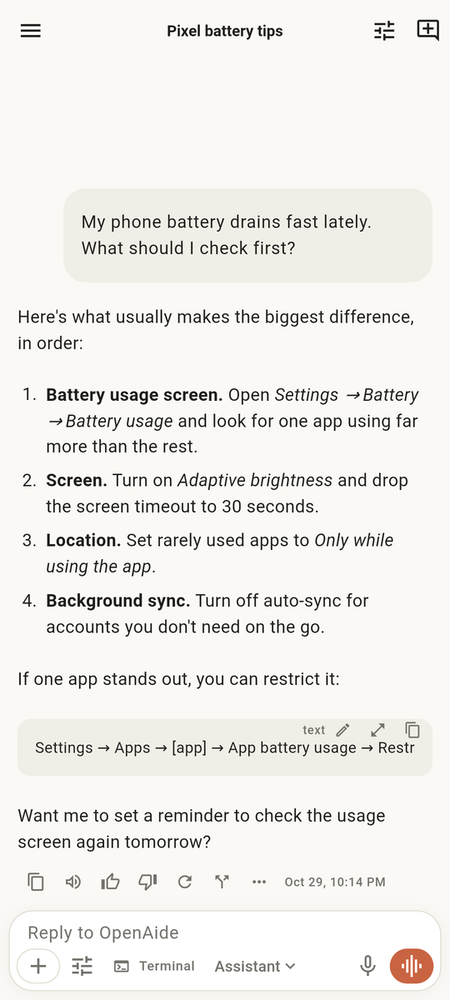
  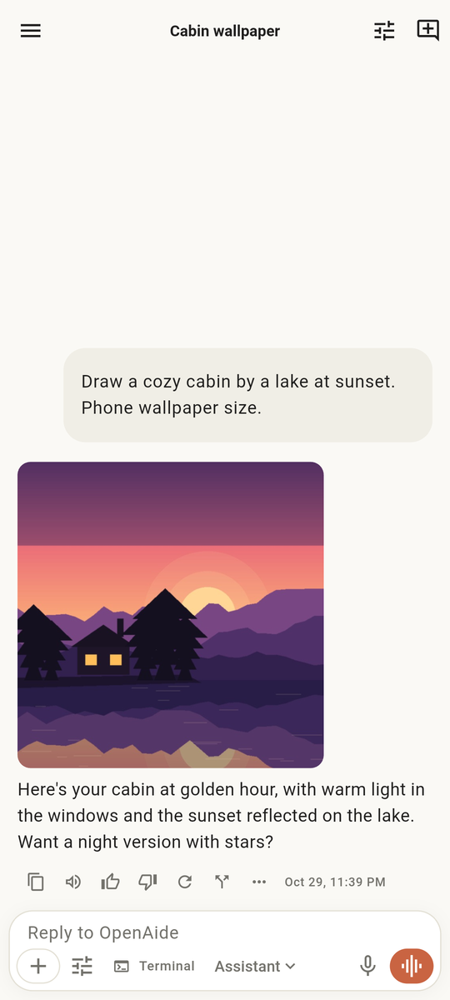
  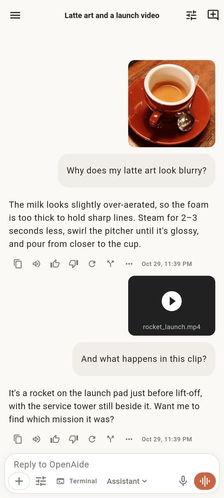
  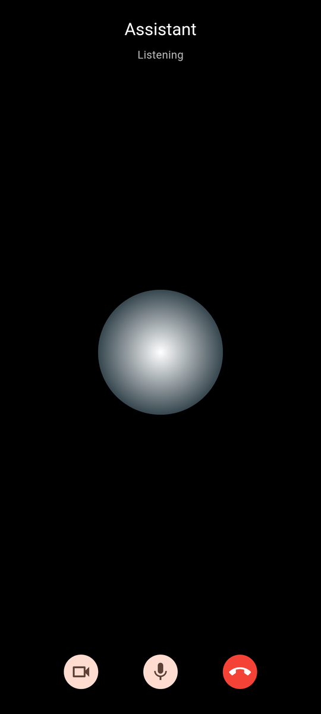
</p>
<p align="center"><sub>Chat · Pictures in chat · Photos and video · Voice call</sub></p>
<p align="center">
  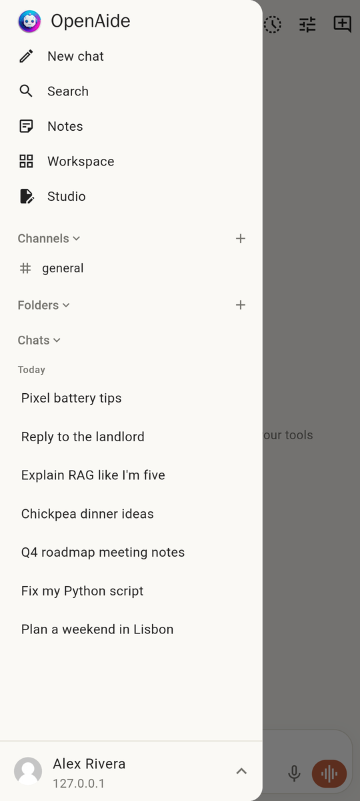
  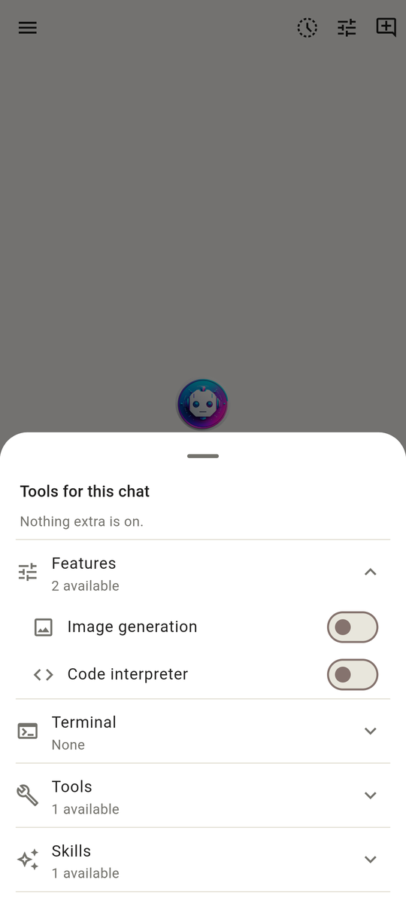
  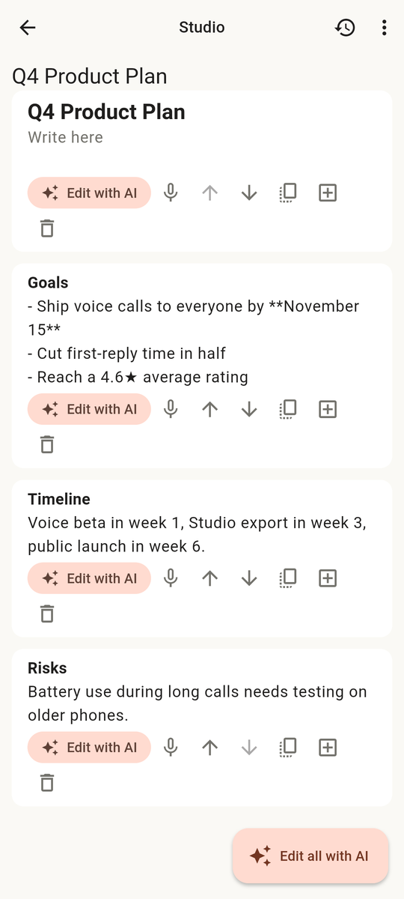
  
</p>
<p align="center"><sub>Side menu · Tools menu · Studio · Notes</sub></p>
<p align="center">
  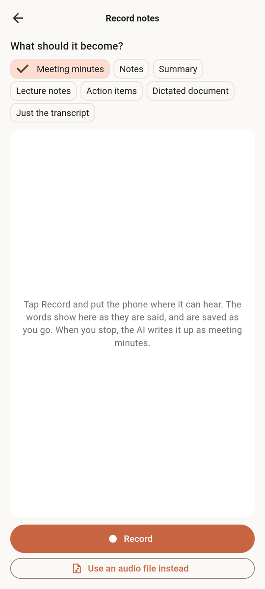
  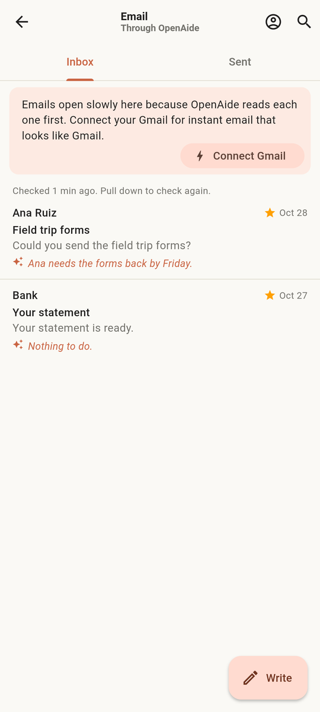
  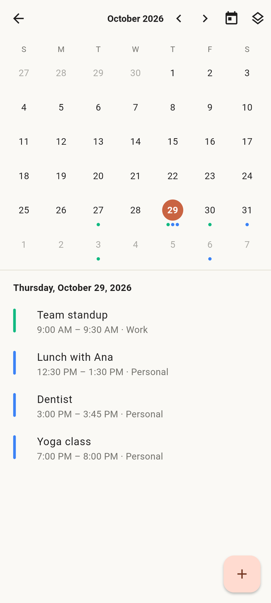
  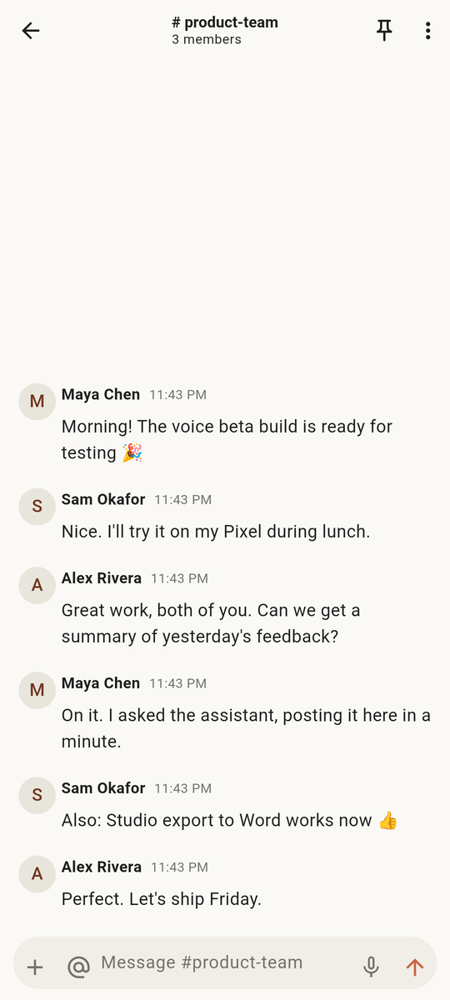
</p>
<p align="center"><sub>Record notes · Email · Calendar · Channels</sub></p>
<p align="center">
  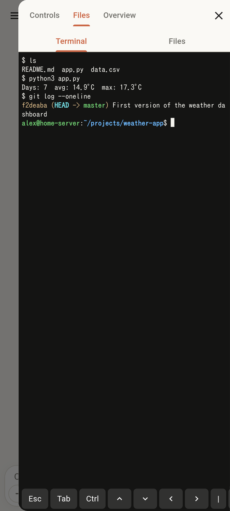
  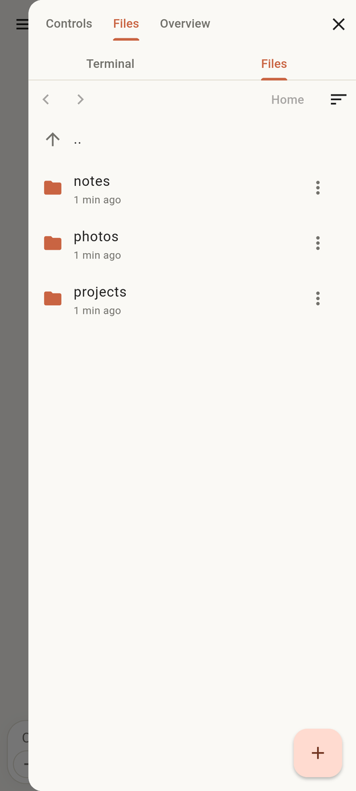
  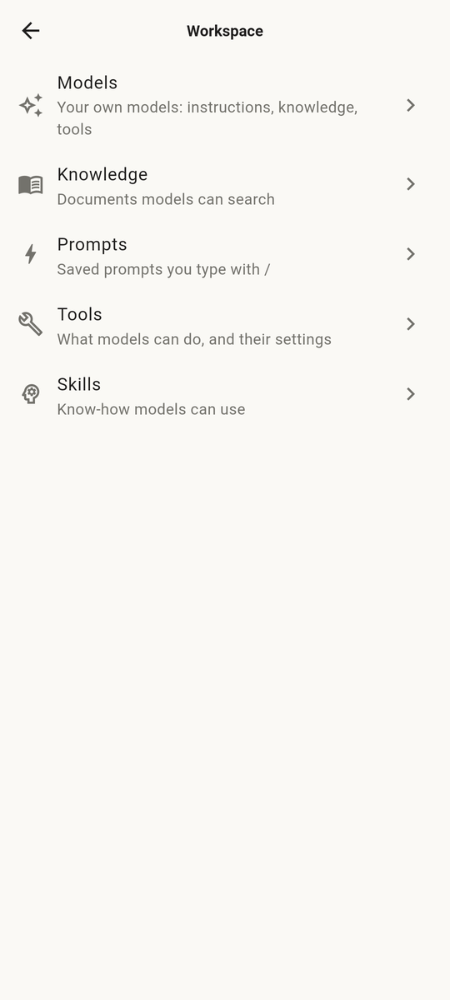
  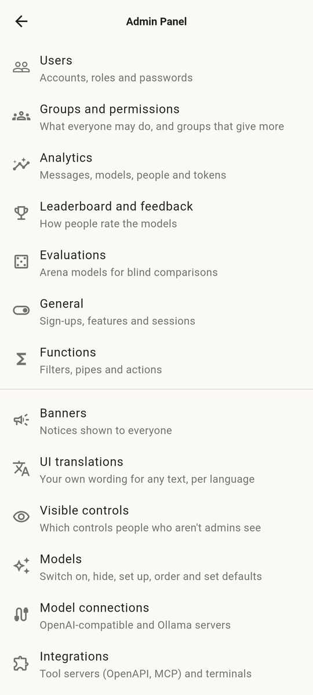
</p>
<p align="center"><sub>Terminal · Files · Workspace · Admin panel</sub></p>

## Features

| | |
|---|---|
| 🔄 **Open WebUI, fully synced** | Chats, models, tools, knowledge, memory, notes, channels and settings live on your server, so the phone and the web UI always match. New models or tools you add on the server appear in the app without an update. |
| 🧠 **Works without a server** | Sign in to OpenRouter or GitHub Copilot, or add a Claude or OpenAI key, and chat straight from the phone, with web search, built-in tools, skills and MCP servers. |
| 📴 **Models on your phone** | Download a small model (llama.cpp, from Hugging Face) and chat completely offline. |
| 🎙️ **Voice** | Hands-free voice calls, video calls with the camera, a wake phrase, dictation and spoken replies. |
| 🤖 **Default assistant** | Set OpenAide as your Android assistant: long-press the power button and ask. It floats over other apps, sets alarms and timers, sends texts and adds events. Share to it from any app, or use the widget and quick tile. |
| 🖼️ **Pictures and video** | Generated pictures show right in the chat. Send photos, videos and files, play videos and voice notes, and see YouTube and tool embeds inside replies. |
| 📝 **Studio** | Write and edit documents, spreadsheets and slides with AI help. Opens and saves Word, Excel and PowerPoint files. |
| 🗒️ **Notes and recordings** | Quick notes that sync with your server. Record a meeting and get minutes, a summary, lecture notes or action items, with a live transcript. Dictate into any note or document. |
| ✉️ **Email** | Read, sort and answer mail through your server or straight over IMAP, and link Google, Microsoft or GitHub accounts. |
| 💻 **Terminal and files** | A full terminal on your server and a file browser in the chat's side panel. Preview PDFs, notebooks and SQLite files, upload folders, and ask the AI to edit selected lines. |
| 💬 **Channels** | Team channels and direct messages, with pins, threads, reactions, webhooks, and a model you can ask right in the channel. |
| 📅 **Calendar and automations** | Calendars with your own colors, and scheduled automations that post their results. |
| 🗂️ **Workspace** | Models, knowledge, prompts, tools and skills, with sharing, versions, import and export. Playground for text and images. |
| 🛡️ **Admin panel** | Users, groups and permissions, connections, Ollama downloads, functions, analytics, banners and every server settings tab, natively. |
| 🎨 **Made to fit you** | The app in your language, light or dark, text size and UI scale, keyboard shortcuts, pinned and default models. |
| 🔒 **Private by design** | No ads, no tracking. Anything that leaves your home network is encrypted, and chats can be end-to-end encrypted. Sign in with a password, API key, SSO, LDAP or two-step codes. |

## Install

OpenAide isn't on Google Play yet, so you install it straight from GitHub. It takes about a minute.

1. **Download.** On your phone, open the [latest release](../../releases/latest) and tap `OpenAide-<version>.apk` under **Assets**.
2. **Open the file.** Tap the download notification, or find the file in your **Downloads**.
3. **Allow the install.** Android asks the first time: tap **Settings**, turn on **Allow from this source** for your browser, then go back and tap **Install**.
4. **If Play Protect warns you,** tap **More details → Install anyway**. It does this for any app that isn't from the Play Store. The full source code is right here, and every release is built automatically by the [Build workflow](.github/workflows/build.yml).
5. **Open OpenAide.**

Needs Android 9 or newer.

## Getting started

The first screen asks how you want to use OpenAide. Pick one, and you can add the others later in **Settings**.

- **I have an Open WebUI server:** enter its address (for example `https://chat.example.com`, or `http://192.168.1.20:3000` at home) and sign in with your email and password, an API key, or your server's sign-on page. Replies run on your server, so its tools, pipelines, filters and knowledge work exactly as on the web. Tested with Open WebUI 0.12.5 (and 0.12.4).
- **Use an AI provider:** sign in to OpenRouter, or paste a Claude or OpenAI API key.
- **Run a model on the phone:** choose one of the recommended small models and download it once. After that it works with no internet.

**Make it your assistant:** in **Settings → Phone and assistant**, tap **Make OpenAide your phone's assistant**, choose **Digital assistant app → OpenAide**, then long-press the power or home button to talk to OpenAide from anywhere.

### Updates

OpenAide checks for new versions when it starts and offers to install them over the top. Your chats and settings stay. In **Settings → App updates** you can pick a channel:

- **Stable:** public releases only (recommended).
- **Dev builds:** every new build, often several a day. Newest features, less tested.

No GitHub account is needed.

### Troubleshooting

- **"App not installed":** a copy signed by someone else (for example one you built yourself) is already on the phone. Uninstall it first.
- **Can't reach my server:** check the address opens in the phone's browser. Away from home, use your server's `https://` address. Plain `http://` is only allowed on your home network.
- **Something else:** [open an issue](../../issues/new) and say what you tapped and what happened.

## Build from source

Requires Flutter (stable) and the Android SDK.

```sh
flutter pub get
flutter test
flutter run            # on a connected device or emulator
flutter build apk      # build/app/outputs/flutter-apk/app-release.apk
```

A build you make yourself is signed with your own key, so it can't install over a release from this repo (and the other way round). Uninstall one before installing the other.

See [docs/ARCHITECTURE.md](docs/ARCHITECTURE.md) for how the app is put together.

## Contributing

Issues and pull requests are welcome. Please describe what you changed and how you tested it. Pull requests from forks don't run the build workflow automatically.

## Privacy and security

See [PRIVACY.md](PRIVACY.md) for what the app stores and sends, and [SECURITY.md](SECURITY.md) to report a vulnerability.

## Support

OpenAide is free, with no ads and no tracking. If it helps you, you can [buy me a coffee](https://buymeacoffee.com/eltibu).

## License

[MIT](LICENSE). Third-party licenses are in [THIRD_PARTY_NOTICES.md](THIRD_PARTY_NOTICES.md).
